<!--
  android reader, novel reader android, manga reader android, video player android, light novel reader, ranobe reader, epub reader android, fb2 reader android, pdf reader android, opds catalog, tts reader, llm translation
  андроид читалка, читалка ранобэ андроид, читалка манги андроид, видеоплеер андроид, читалка новелл, epub читалка андроид, fb2 читалка андроид, pdf читалка андроид, opds каталог, аудиокниги андроид, озвучка книг, перевод книг llm
-->
<div align="center">


# MiruTime

Бесплатная читалка новелл, манги и видео с открытым исходным кодом для Android.

[🇬🇧 English](README.md) · 🇷🇺 Русский

[](https://github.com/HnDK0/MiruTime/releases/latest)
[](https://github.com/HnDK0/MiruTime/releases)
[](LICENSE)
[](https://github.com/HnDK0/MiruTime/releases/latest)

> ⭐️ **Если вам нравится MiruTime, поставьте звезду репозиторию!** Это помогает проекту развиваться.

</div>

---

## Скачать

**[Получить последний APK](https://github.com/HnDK0/MiruTime/releases/latest)** — требуется Android 8.0+

В релизе два APK: `arm64-v8a` для большинства устройств и `universal` для остальных.

Или собрать из исходников:

```bash
git clone https://github.com/HnDK0/MiruTime
# Откройте в Android Studio и запустите на устройстве или эмуляторе
```

---

## Возможности

- Источники на Lua-плагинах с установкой из репозитория или файла `.lua`
- Каталог источников с фильтрами, закреплёнными источниками и поиском
- Локальная библиотека EPUB, FB2 и PDF — по одной книге или пакетом; PDF читаются постранично
- Каталоги OPDS как источники библиотеки — Atom 1.2 (XML) и OPDS 2.0 (JSON), с фасетами, поиском, постраничной навигацией и Basic-авторизацией
- Аудиокниги из каталогов OPDS — потоковое воспроизведение по трекам в плеере с сохранением прогресса
- Читалка с настройками шрифта, темы, фона и межстрочного интервала
- Перевод прямо в читалке: обычный и параллельный режим (оригинал рядом с переводом)
- Перевод для отдельной книги или выбранных глав, не трогая глобальные настройки
- Очередь перевода скачанных глав
- Озвучка текста (TTS) с фоновым воспроизведением и управлением из плеера
- Читалка манги с кешем страниц и ограничением размера кеша
- Видеоплеер с выбором рабочего источника и загрузкой видео
- Менеджер загрузок: очередь, прогресс, очистка по типам данных
- Обновления библиотеки в фоне и проверка новых версий приложения
- Очистка текста регулярными выражениями: предпросмотр, импорт/экспорт правил
- Миграция книг между источниками с переносом прогресса, текста и переводов
- Резервное копирование: ручное и автоматическое по расписанию, слияние бэкапов
- Импорт резервных копий NoveLA
- Полки и обновления в библиотеке, дашборд с активностью чтения
- Экспорт книги в EPUB с экрана книги
- Десять языков интерфейса: английский, русский, испанский, португальский, французский, немецкий, итальянский, турецкий, вьетнамский и индонезийский
- Светлая и тёмная тема, Material 3

---

## Перевод

Поддерживаемые движки:

| Движок | Стоимость | API-ключ |
|---|---|---|
| Google Translate (улучшенный) | Бесплатно | Не требуется |
| Google Translate (простой) | Бесплатно | Не требуется |
| Google Gemini | По тарифу | Требуется |
| OpenAI | По тарифу | Требуется |
| OpenAI-совместимый | Зависит от провайдера | Требуется |
| Anthropic | По тарифу | Требуется |
| DeepL | Бесплатный и Pro-тарифы | Требуется |
| Yandex Cloud Translate | По тарифу | Требуется (ключ и folder ID) |
| Yandex Translate (неофициальный) | Бесплатно | Не требуется |
| Yandex Browser Translation | Бесплатно | Не требуется |

OpenAI-совместимый режим работает с OpenRouter, Mistral, DeepSeek, Ollama и любыми совместимыми эндпоинтами, включая локальные LLM-серверы в сети.

Параллельный режим показывает оригинал и перевод рядом. Языковая пара берётся в порядке: книга → плагин → глобальные настройки.

---

## Плагины

Источники подключаются внешними Lua-плагинами — из приложения: **Поиск → Расширения → репозиторий**.

Официальный репозиторий плагинов: [`HnDK0/external-sources`](https://github.com/HnDK0/external-sources)

Также можно установить отдельный `.lua` файл — он проверяется перед сохранением.

---

## 📱 Интерфейс приложения

<div align="center">

### Главный экран и библиотека
| Дашборд | Библиотека | Фильтры | Доп. экраны |
| :---: | :---: | :---: | :---: |
| 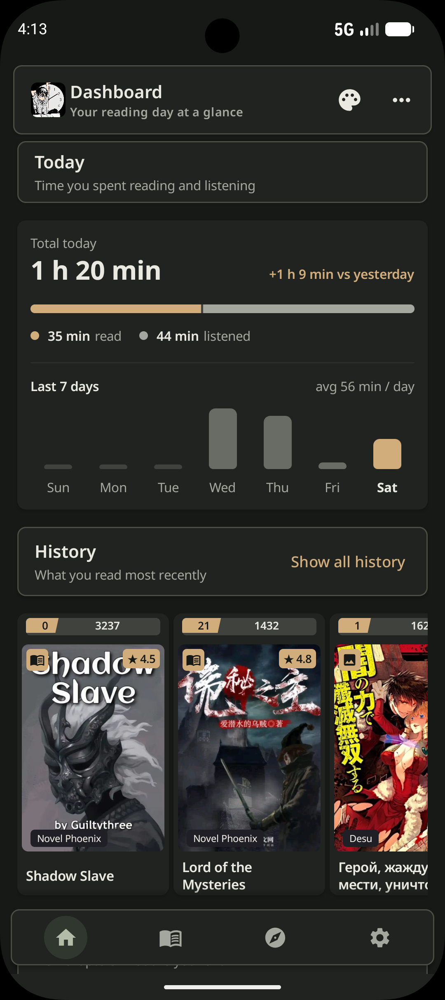 | 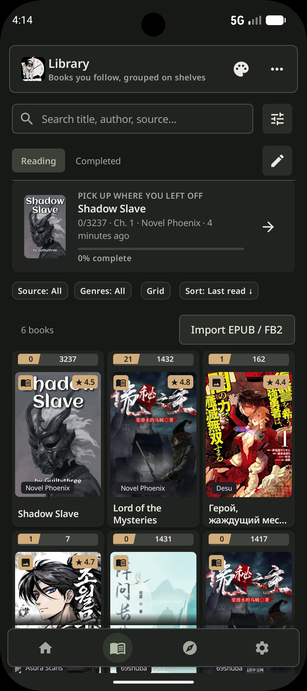 | 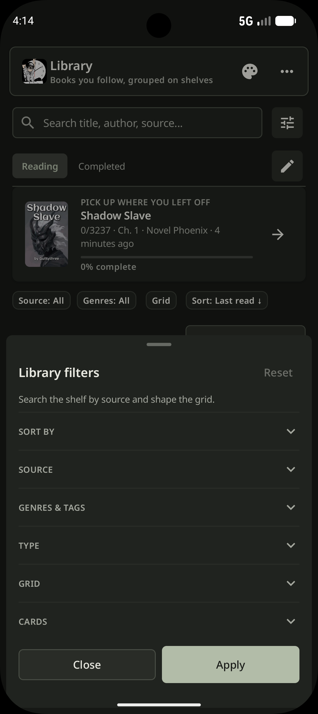 | 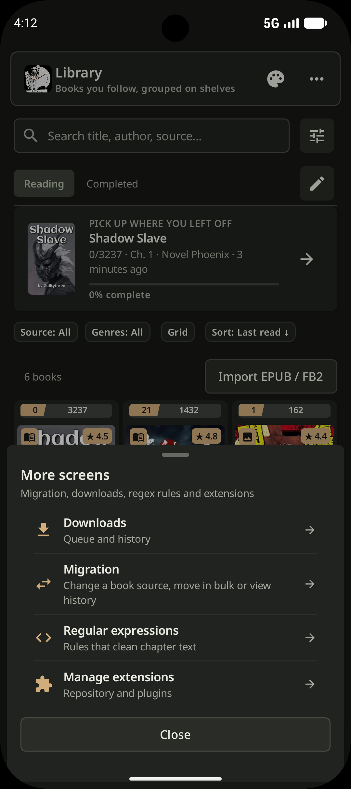 |

### Источники, загрузки и миграция
| Каталог (Finder) | Расширения | Загрузки и кэш | Миграция |
| :---: | :---: | :---: | :---: |
| 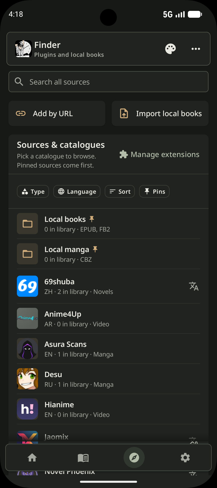 | 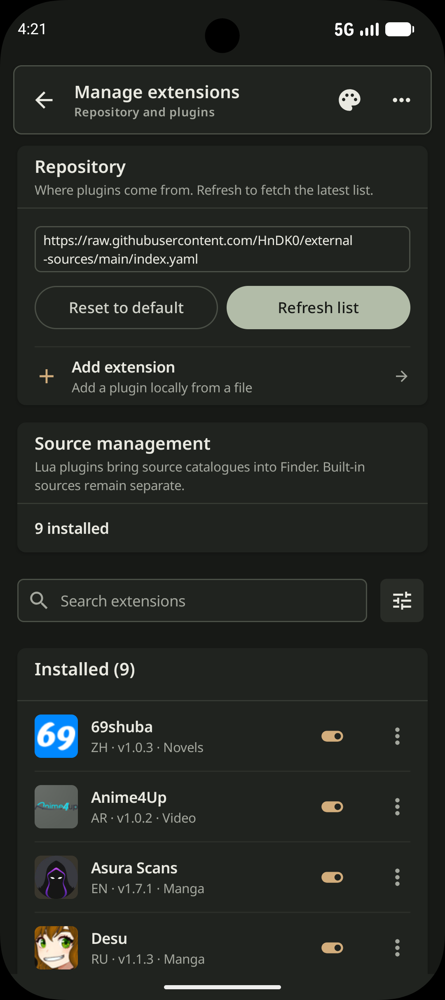 | 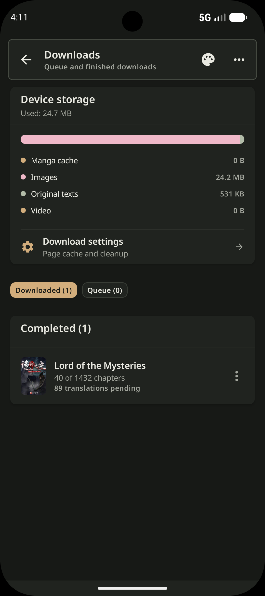 | 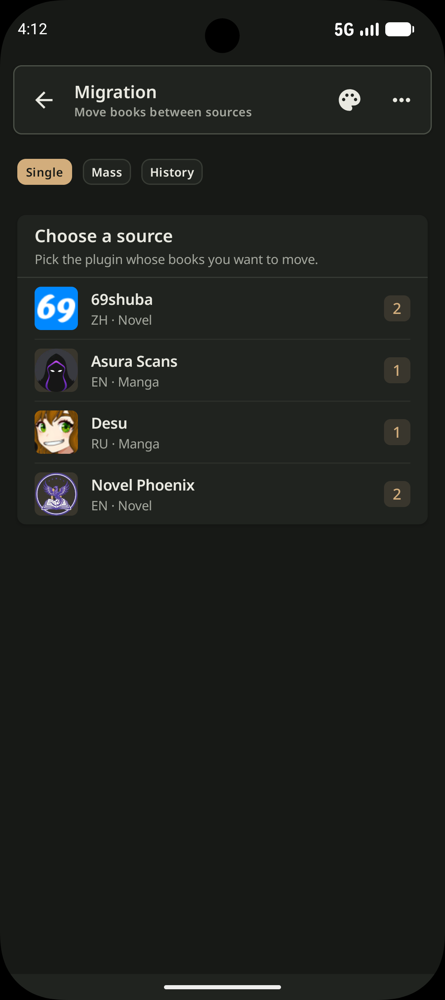 |

### Детали книги и чтение новелл
| О книге | Список глав | Читалка текста | Озвучка (TTS) |
| :---: | :---: | :---: | :---: |
| 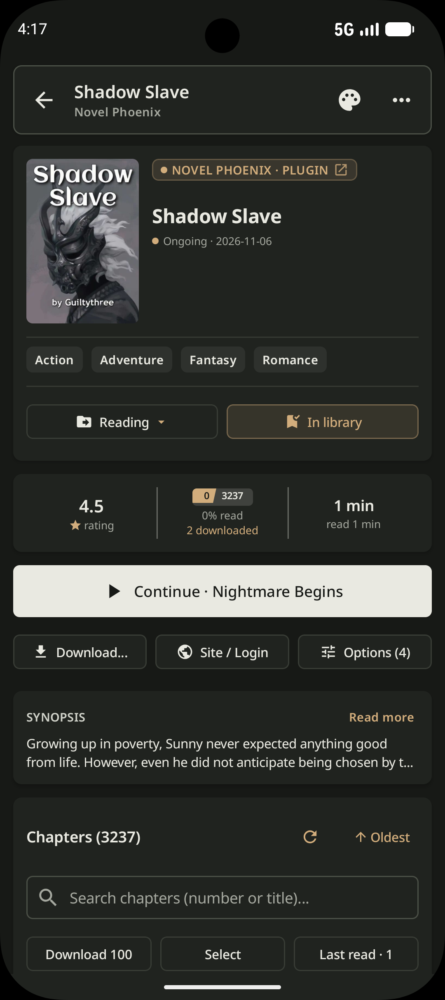 | 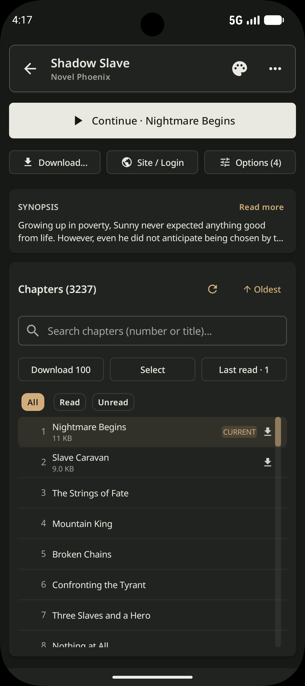 | 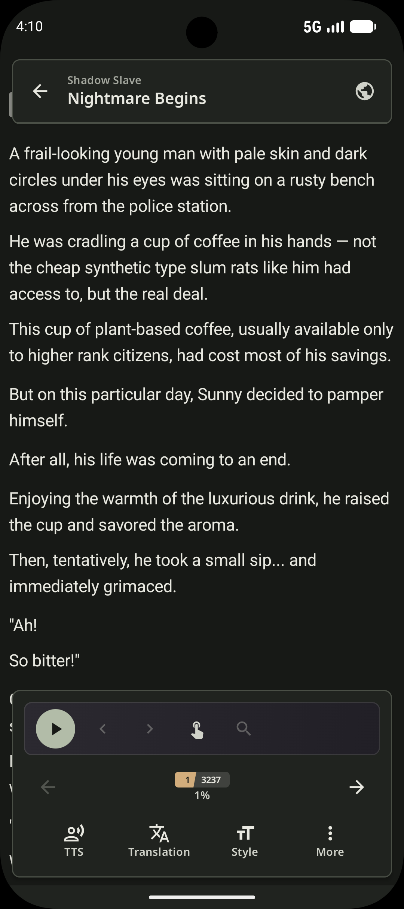 | 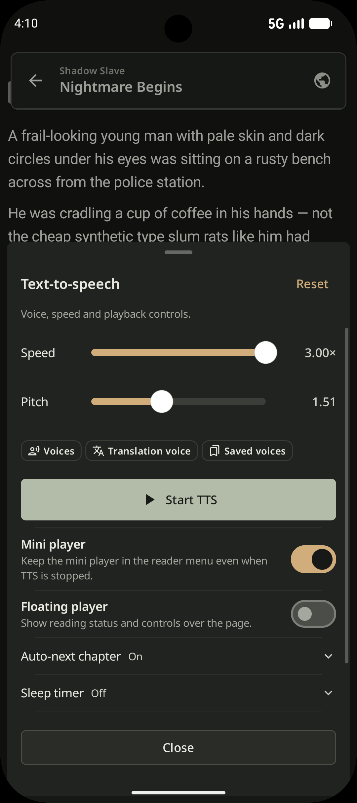 |

| Перевод (LLM) | Стиль и шрифты | Доп. опции чтения |
| :---: | :---: | :---: |
| 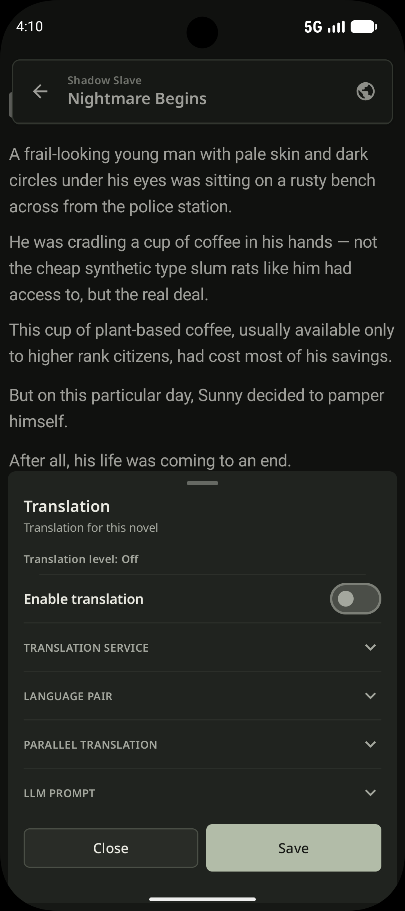 | 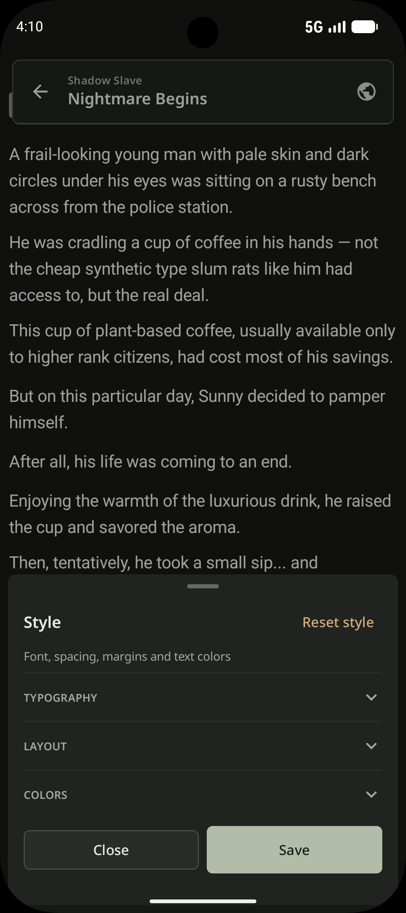 | 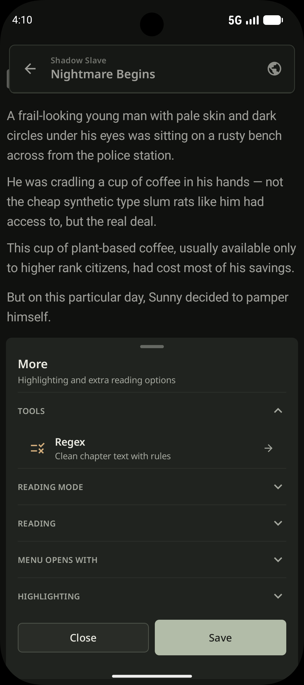 |

### Манга и Видеоплеер
| Читалка манги | Настройки манги | Видеоплеер | Настройки плеера |
| :---: | :---: | :---: | :---: |
| 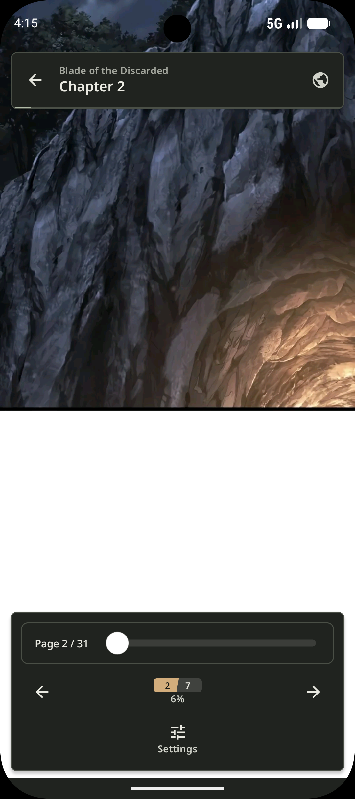 | 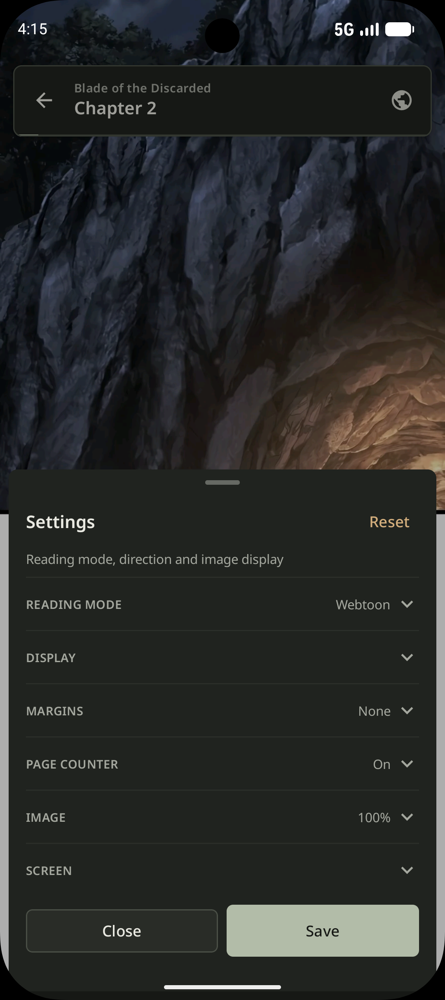 | 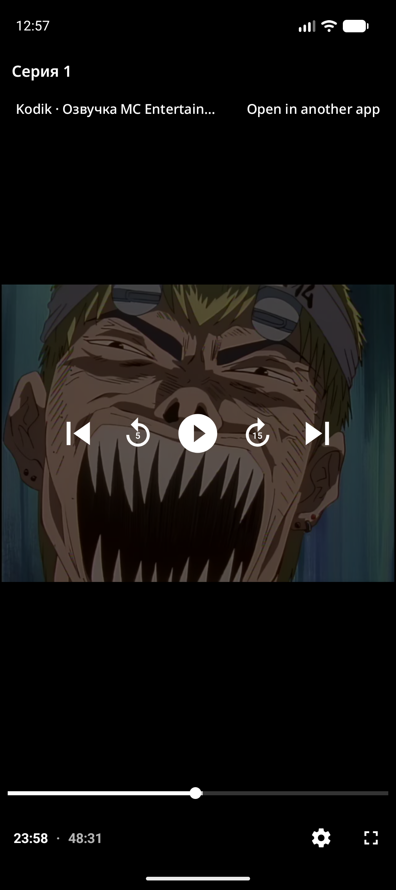 | 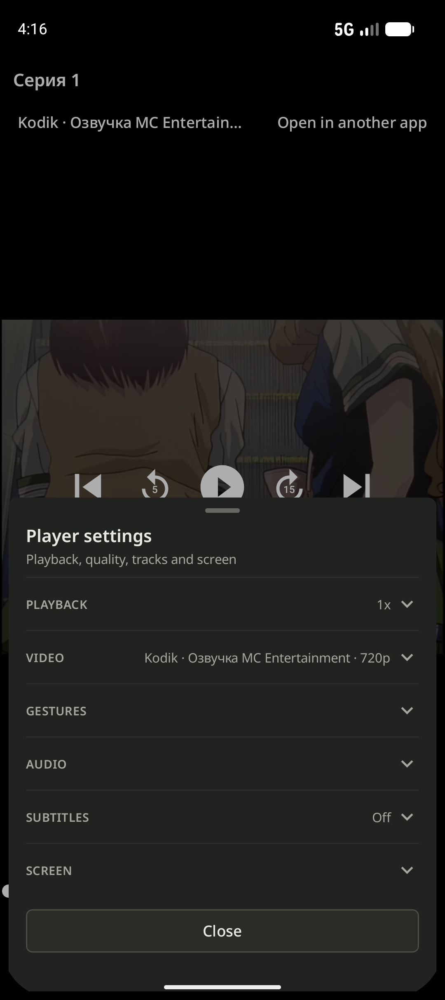 |

### Regex, обновления и настройки
| Очистка Regex | Обновления | Настройки |
| :---: | :---: | :---: |
| 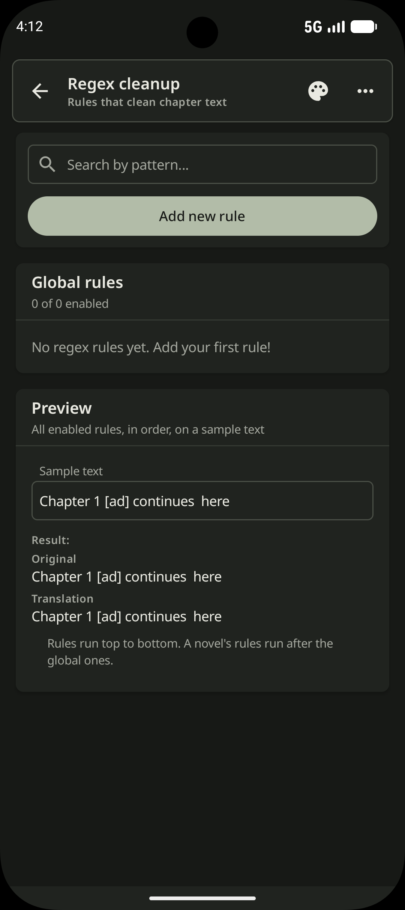 | 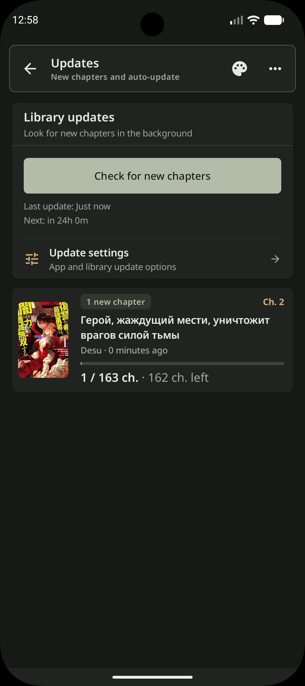 | 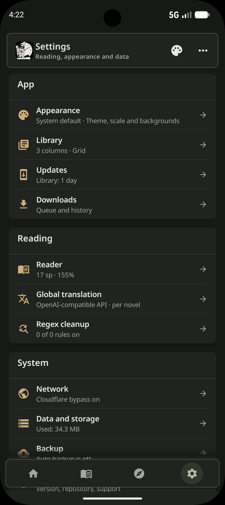 |

</div>

---

## Вклад в проект

Любая помощь приветствуется — сначала прочитайте [CONTRIBUTING.md](CONTRIBUTING.md):

- ⭐️ **Поставить звезду** репозиторию — самый простой способ поддержать разработку.
- 🐛 **Сообщить о баге или предложить улучшение** через [Issues](https://github.com/HnDK0/MiruTime/issues).
- 🧩 **Исправить ошибку или добавить источник** через Pull Request (для плагинов используйте [external-sources](https://github.com/HnDK0/external-sources)).
- 🔒 **Сообщить об уязвимости** приватно по [SECURITY.md](SECURITY.md), не в публичном issue.

---

## Технологии

Kotlin · Coroutines · Jetpack Compose · Material 3 · Room (KMP) · Ktor · Ksoup · Coil 3 · LuaJ · WorkManager · Media3 · OkHttp · Android TTS & Media APIs

Проект разделён на модули: `:app`, `:ui-kit`, `:feature-reader`, `:feature-tts`, `:core-reader-model`, `:mirutime-core`, `:mirutime-data`, `:translator`, `:core-log`, `:image-loader`.

---

## Лицензия

[GPL-3.0](LICENSE)
